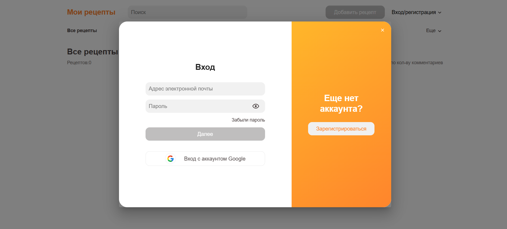
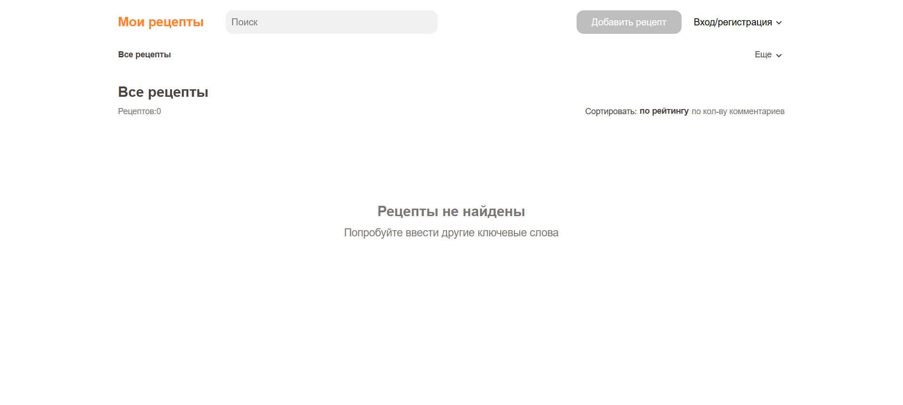

# 🍳 Neo-Cook-Book — Online Recipe Platform

**Neo-Cook-Book** — веб-приложение для просмотра кулинарных рецептов, разработанное в рамках проекта **NeoBook**.

Платформа предоставляет пользователям удобный интерфейс для знакомства с различными рецептами, просмотра информации о приготовлении блюд и изучения кулинарного контента.

Проект был реализован в команде из двух разработчиков: Frontend Developer и Backend Developer. Я отвечал за полную разработку клиентской части приложения — от реализации пользовательского интерфейса до интеграции с серверной частью через API.

---

## 📸 Screenshots

### Main Interface



### Additional Interface



---

## ✨ Features

- 🍽️ **Recipe Catalog** — просмотр доступных кулинарных рецептов.
- 📖 **Recipe Details** — отображение подробной информации о рецептах.
- 🔐 **Authentication** — регистрация и авторизация пользователей.
- 🔑 **Google OAuth** — возможность авторизации через Google.
- 🔎 **Recipe Navigation** — удобная навигация по разделам приложения.
- 📄 **Pagination** — постраничная навигация по контенту.
- 📝 **Form Validation** — проверка пользовательских данных с помощью Yup и Formik.
- 🔔 **Notifications** — информирование пользователей о результатах их действий.
- 📱 **Responsive UI** — адаптация интерфейса под различные устройства.
- 🔗 **API Integration** — взаимодействие с Backend через REST API.

---

## 🛠 Tech Stack

| Category | Technologies |
|---|---|
| Core | React 18, JavaScript |
| UI Library | Material UI (MUI) |
| Styling | SCSS, Emotion |
| State Management | Redux Toolkit, React Redux |
| Routing | React Router DOM |
| HTTP Client | Axios |
| Authentication | Google OAuth, JWT |
| Forms & Validation | Formik, Yup |
| UI Components | React Select, React Paginate, React Toastify, React Pin Input |
| Development Tools | Git, npm, VS Code |

---

## 🏗 Architecture & Development

Проект построен на React с использованием компонентного подхода и Redux Toolkit для управления состоянием приложения.

В процессе разработки особое внимание уделялось:

- Созданию переиспользуемых UI-компонентов.
- Организации структуры Frontend-приложения.
- Управлению глобальным состоянием через Redux Toolkit.
- Интеграции с Backend API с использованием Axios.
- Реализации пользовательской авторизации и обработки JWT-токенов.
- Валидации форм и обработке ошибок.
- Созданию удобного и адаптивного пользовательского интерфейса.

---

## 💻 Installation & Setup

### 1. Clone the repository

```bash
git clone <REPOSITORY_URL>
```

### 2. Install dependencies

```bash
npm install
```

### 3. Start the development server

```bash
npm start
```

После запуска приложение будет доступно по адресу:

[http://localhost:3000](http://localhost:3000)

---

## 👨‍💻 My Contribution

**Дастан Алмазбеков — Frontend Developer**

Отвечал за полную разработку Frontend-части проекта.

Основные обязанности:

- Разработка всей клиентской части приложения на React.
- Создание пользовательского интерфейса и компонентов.
- Реализация логики взаимодействия пользователя с приложением.
- Настройка Redux Toolkit и управление состоянием.
- Интеграция с Backend API через Axios.
- Реализация регистрации и авторизации пользователей.
- Интеграция Google OAuth.
- Работа с JWT-токенами.
- Реализация и валидация форм с Formik и Yup.
- Разработка адаптивной вёрстки с использованием SCSS и Material UI.
- Обработка ошибок, уведомлений и пользовательских действий.

**Team:** 2 developers — Frontend Developer & Backend Developer.

---

## 🎓 Project & Learning Platform

Проект разработан в рамках **NeoBook**.

🌐 **Project:** [NeoBook — Visit Website](<https://neobisclubs.notion.site/5-335bc5471f614125bbd354d13e51b89f>)

🎓 **Course:** [Explore and Purchase the Course](<https://neobisclubs.notion.site/Cook-Book-f9a1f094f96343d792d7af6e1f5c805e>)

---

## 📌 Project Status

**Completed** — разработка выполнена в рамках проекта NeoBook совместно с Backend Developer.

---

⭐ Thanks for checking out Neo-Cook-Book!